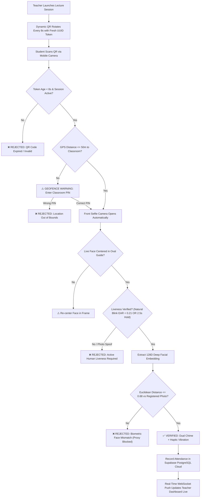
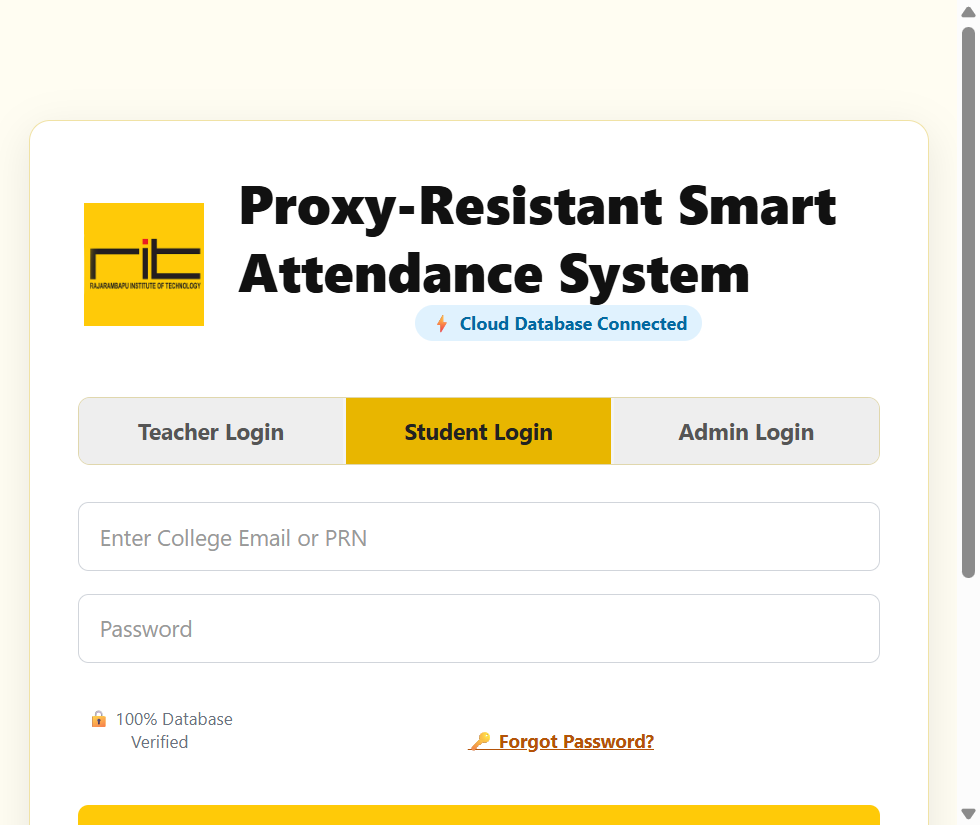
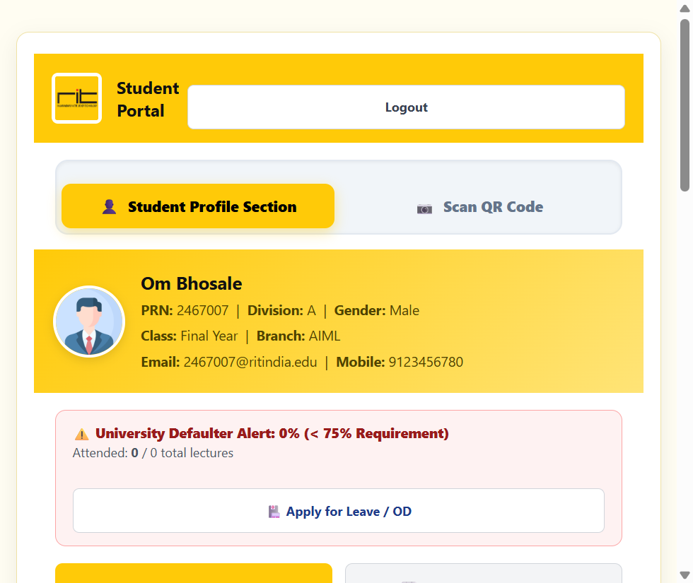
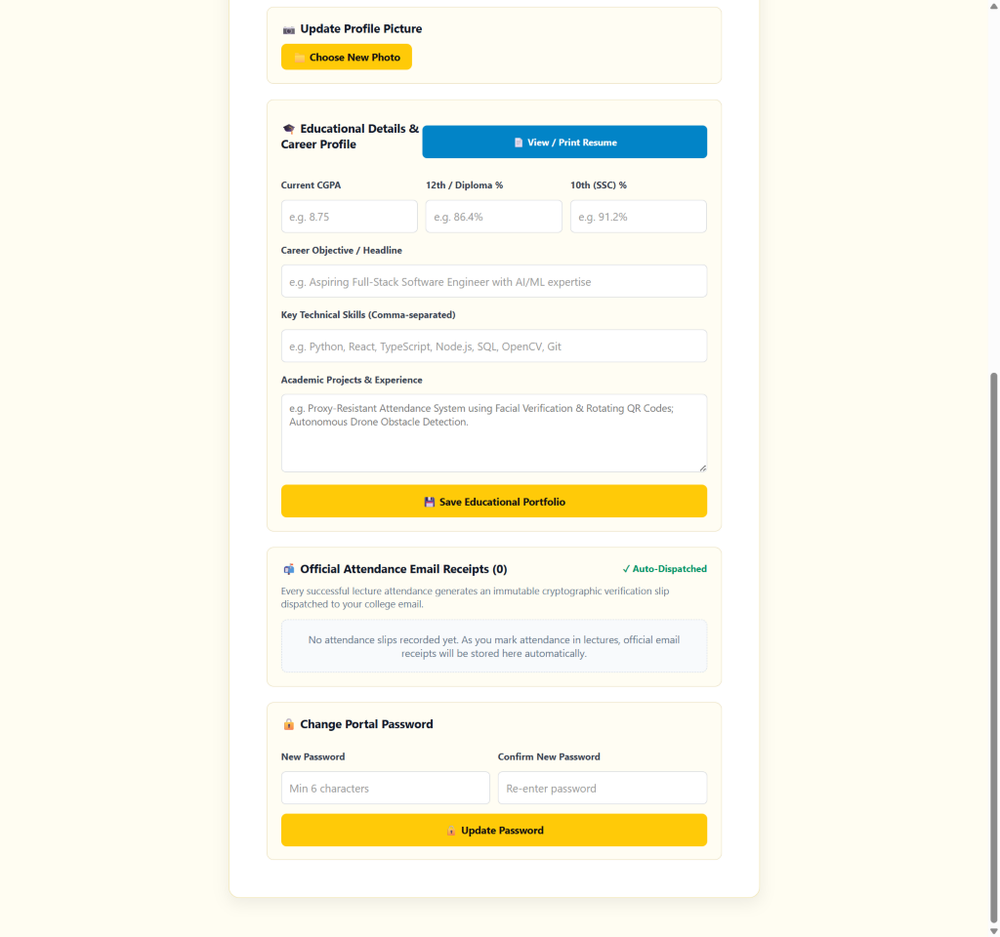
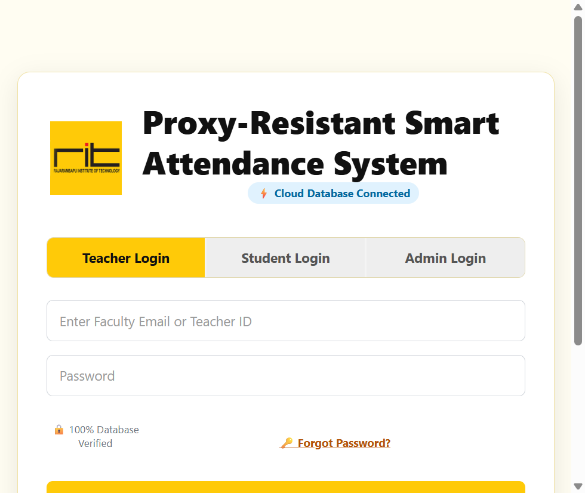
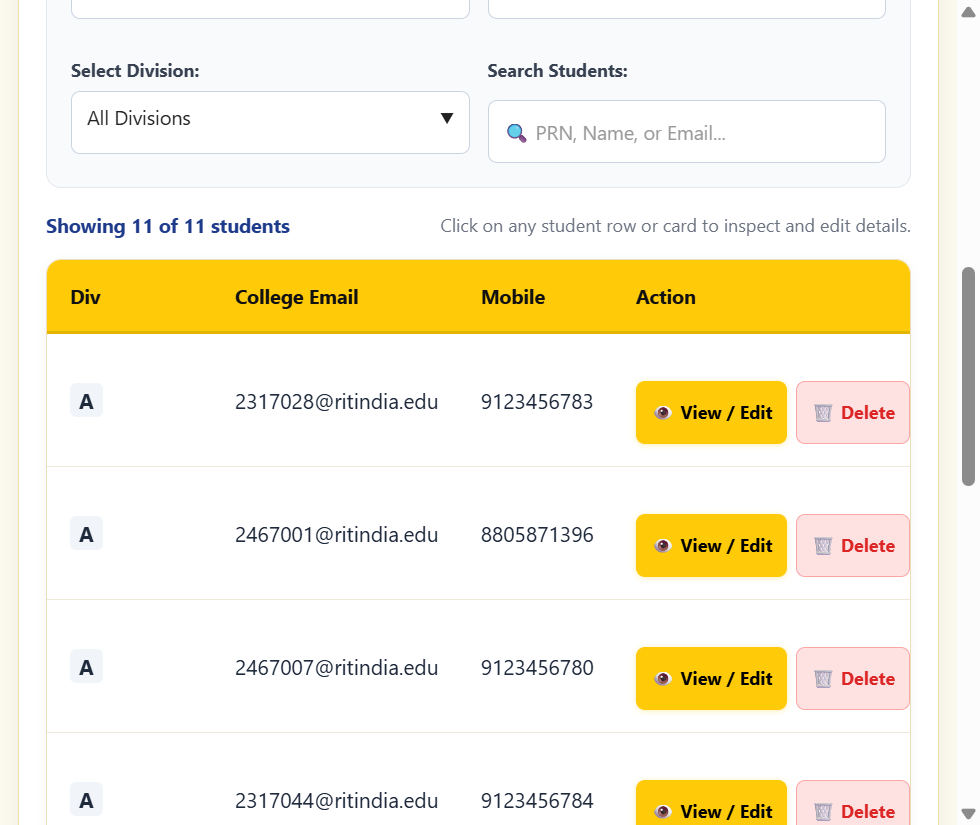

<div align="center">

# 🎯 Proxy-Resistant Real-Time QR & Cloud Smart Attendance System

### Autonomous, AI-Powered Multi-Factor Biometric Attendance Management with Browser-Native Edge Deep Learning
**Kasegaon Education Society's Rajarambapu Institute of Technology (RIT), Rajaramnagar**  
*Department of Computer Science & Engineering (Artificial Intelligence and Machine Learning)*  
**B.Tech Capstone Project (Phase I & Phase II)**

---

[](https://smart-attendance-system-six-xi.vercel.app)
[](#)
[](#)
[](#)
[](#)
[](#)
[](#)
[](#)
[](LICENSE)

<br/>

### 🌐 [**🚀 Launch Live Web Application (Click to Test)**](https://smart-attendance-system-six-xi.vercel.app)
*Works universally across all mobile smartphones (Android/iOS), tablets, and desktop browsers with zero app installation.*

---

</div>

## 📌 Quick Access Credentials for Live Demo

| Role | Access URL | Test Identifier / Email | Test Password | Capabilities |
| :--- | :--- | :--- | :--- | :--- |
| **👨‍🏫 Teacher** | `/teacher/login` | `teacher@rit.edu` | `Teacher@123` | Create lectures, 8-second rotating dynamic QR, live attendee stream, export Excel (.xlsx) |
| **👨‍🎓 Student** | `/student/login` | `2467001` or `atharvkadam1858@gmail.com` | `Student@1234` | Scan dynamic QR, GPS location latch, front-camera blink liveness & face match |
| **🛡️ Admin** | `/admin/login` | `admin@rit.edu` | `Admin@123` | Institutional dashboard, student/teacher CRUD, delete students, 75% defaulter lists |

---

## 📖 Table of Contents

- [About the Project](#-about-the-project)
- [The Problem: Proxy Attendance](#-the-problem-proxy-attendance)
- [Core Anti-Proxy Defense Architecture](#-core-anti-proxy-defense-architecture)
- [Live Production Screenshots](#-live-production-screenshots)
- [System Architecture & UML Diagrams](#-system-architecture--uml-diagrams)
- [Edge AI Biometric & Liveness Engine](#-edge-ai-biometric--liveness-engine)
- [Mathematical Formulations](#-mathematical-formulations)
- [Technology Stack & Zero-Cost Architecture](#-technology-stack--zero-cost-architecture)
- [Database Schema & Data Dictionary](#-database-schema--data-dictionary)
- [Local Installation & Development Guide](#-local-installation--development-guide)
- [Cloud Deployment Guide (Vercel + Supabase)](#-cloud-deployment-guide-vercel--supabase)
- [Quality Assurance & Test Cases](#-quality-assurance--test-cases)
- [Academic Dossier & Credits](#-academic-dossier--credits)

---

## 💡 About the Project

Traditional college attendance recording mechanisms—pen-and-paper signature sheets, manual roll calls, static QR codes, and RFID swipe cards—are plagued by **proxy attendance**, **buddy punching**, and **wasted instructional lecture time**. 

The **Proxy-Resistant Smart Attendance System** completely closes these vulnerabilities by enforcing a **3-factor cryptographic and biological identity verification pipeline** running on a **Bring-Your-Own-Device (BYOD)** model:
1. **Time Freshness (Cryptographic Rotating QR):** Rotates every 8 seconds with strict Time-To-Live (TTL), preventing screenshot forwarding on WhatsApp.
2. **Spatial Binding (GPS Haversine Geofencing):** Confirms the student's smartphone is within 50 meters of the classroom coordinates.
3. **Biological Binding (Browser-Native Edge AI):** Enforces voluntary eye blink liveness detection using Eye Aspect Ratio (EAR $< 0.21$) and matches live facial features against registered college photos using 128-dimensional ResNet-34 deep embeddings.

The entire production platform operates at **₹0 institutional budget**, completely eliminating expensive dedicated hardware, wall-mounted fingerprint scanners, and cloud GPU rental fees.

---

## 🛑 The Problem: Proxy Attendance

```
                              ISHIKAWA (FISHBONE) 6-CAUSE ANALYSIS
PEOPLE                       METHODS                     MACHINES
Peer pressure to sign       Paper sheets lack identity   Wall scanners degrade & smudge
Faculty manual exhaustion   Manual roll call wastes time High hardware purchase cost
Cognitive counting fatigue  No physical location binding Single-point door bottlenecks
        \                       \                           /
         \                       \                         /
          \                       \                       /
           -----------------------------------------------------> [ PROXY ATTENDANCE ]
          /                       /                       \
         /                       /                         \
        /                       /                           \
Static QR forwarded on chat Paper altered or lost        Large halls prevent visual check
Cards physically swapped    Data entry takes weeks        Weak indoor cellular signals
No cryptographic expiry     Late defaulter generation     Multipath GPS drift indoors
MATERIALS                   MEASUREMENT                  ENVIRONMENT
```

### Root Cause (5-Whys Analysis):
* **Why do students commit proxy attendance?** Absent students can be marked present by their friends without consequences.
* **Why can friends mark attendance for them?** Traditional tokens (signatures, RFID cards, static QR photos) can be physically shared without physical presence.
* **Why can tokens be shared?** Because they lack cryptographic expiration and biological identity binding.
* **Why are tokens decoupled from biological identity?** Institutions lacked real-time biometric verification bound to the device scanning the token.
* **Why was real-time biometric verification not implemented previously?** Legacy systems believed biometric AI required expensive dedicated hardware and high-end cloud GPU servers.
* **Our Solution:** Implement client-side Edge AI on students' personal smartphones coupled with rotating 8-second cryptographic QR codes, achieving unforgeable multi-factor verification at **₹0 budget**.

---

## 🛡️ Core Anti-Proxy Defense Architecture

Our verification pipeline follows a **Zero-Trust Multi-Factor Sequence**:



---

## 📸 Live Production Screenshots

The following screenshots are captured directly from our live deployed production application on Vercel:

| 1. Privacy-Shielded Multi-Role Login | 2. Teacher 8-Second Dynamic QR Session |
| :---: | :---: |
|  |  |
| *Role switching (Student / Teacher / Admin) with privacy protection* | *Dynamic rotating cryptographic QR code refreshed every 8 seconds* |

| 3. Student Mobile Attendance Dashboard | 4. Live Liveness Camera with Oval Guide |
| :---: | :---: |
|  |  |
| *Personal attendance history, cumulative percentage & subject stats* | *Active face detection with eye aspect ratio (EAR) landmark tracking* |

| 5. Emergency Face Verification Action | 6. Live Biometric Match & Instant Confirmation |
| :---: | :---: |
|  |  |
| *Direct manual verification with strict pre-capture open-eyes check* | *Sub-200ms 128D embedding match with registered college photo* |

| 7. Admin Console with Student Deletion | 8. Real-Time Defaulter Analytics Report |
| :---: | :---: |
|  |  |
| *Add/Edit/Delete students, teachers, and admins with confirmation* | *Automated institutional 75% defaulter tracking & Excel export* |

---

## 🏗 System Architecture & UML Diagrams

| Diagram Name | Architecture Specification | Preview |
| :--- | :--- | :---: |
| **System Architecture** | Multi-tier distributed architecture spanning presentation, edge CDN, client-side Edge AI, and Supabase cloud database. | [View Diagram](screenshots/f_architecture.png) |
| **Class & Object Model** | OOP structure showing `User` base class, `Student`, `Teacher`, `AttendanceSession`, and `AttendanceRecord` entities. | [View Diagram](screenshots/f_classdiagram.png) |
| **Teacher Workflow** | Sequential flowchart of lecture creation, GPS coordinate latching, dynamic QR rotation, and Excel export. | [View Diagram](screenshots/f_teacherflow.png) |
| **Student Workflow** | Step-by-step verification flow from QR scanning, geofence validation, eye blink liveness, to biometric matching. | [View Diagram](screenshots/f_studentflow.png) |
| **DFD Level 0 (Context)** | System context diagram depicting external entities (Student, Teacher, Admin, HOD) and external data flows. | [View Diagram](screenshots/f_dfd0.png) |
| **DFD Level 1 (Decomposition)** | Process decomposition into Auth (1.0), Sessions (2.0), Verification Pipeline (3.0), and Analytics (4.0). | [View Diagram](screenshots/f_dfd1.png) |
| **Use Case Diagram** | Actors and functional use cases with `<<include>>` and `<<extend>>` validation constraints. | [View Diagram](screenshots/f_usecase.png) |
| **Sequence Diagram** | Chronological message sequence tracing cryptographic token generation, validation, and real-time WebSocket push. | [View Diagram](screenshots/f_sequence.png) |
| **Activity Diagram** | Swimlane decision logic detailing token TTL, geofence radius, landmark integrity, and Euclidean distance rules. | [View Diagram](screenshots/f_activity.png) |
| **Database Design** | Physical schema diagram of relational tables, foreign keys, indexes, and constraints. | [View Diagram](screenshots/f_dbdesign.png) |
| **Entity-Relationship (ER)** | Crow's foot cardinality model representing 1:1, 1:N, and composite unique relationships. | [View Diagram](screenshots/f_erdiagram.png) |

---

## 🤖 Edge AI Biometric & Liveness Engine

The core biometric artificial intelligence engine runs **completely inside the student's mobile browser** via `@vladmandic/face-api`, utilizing WebGL GPU acceleration and WebAssembly:

```
                  CLIENT-SIDE EDGE AI PIPELINE
                  
[ Mobile Camera Video Stream (640x480 @ 30fps) ]
                       |
                       v
     [ TinyFaceDetector (SSD Mobile Architecture) ]
     --> Detects bounding box in 15-30ms
                       |
                       v
     [ FaceLandmark68Net (68-Point Neural Mesh) ]
     --> Extracts coordinates: eyes, nose, mouth, jawline
                       |
                       v
     [ Real-Time Liveness Engine (Soukupová & Čech EAR) ]
     --> Measures Eye Aspect Ratio: Closed < 0.21, Open >= 0.22
     --> Verifies voluntary human blink within 40ms - 1500ms
     --> OR: 2.5s continuous steady face-lock hold
                       |
                       v
     [ FaceRecognitionNet (34-Layer Deep Residual CNN) ]
     --> Ingests aligned face chip and computes 128D embedding
                       |
                       v
     [ Deep Metric Comparison & Decision Threshold ]
     --> Fetches registered 128D descriptor (0ms pre-warmed cache)
     --> Computes Euclidean Distance: d = ||u - v||_2
     --> Decision: If d <= 0.68 -> BIOMETRIC MATCH CONFIRMED (e.g. 94%)
     --> Decision: If d > 0.68  -> PROXY BLOCKED (Face Mismatch)
```

---

## 📐 Mathematical Formulations

### 1. Eye Aspect Ratio (EAR) for Active Blink Liveness
$$\text{EAR} = \frac{\|p_2 - p_6\| + \|p_3 - p_5\|}{2.0 \cdot \|p_1 - p_4\|}$$
* $p_1, p_4$: Horizontal eye corner landmarks (points 36 & 39 for left eye; 42 & 45 for right eye).
* $p_2, p_6$ and $p_3, p_5$: Vertical eyelid landmark pairs.
* **Thresholds:** Closed eye $\text{EAR} < 0.21$; Open eye $\text{EAR} \ge 0.22$. A valid voluntary blink occurs when EAR drops below 0.21 and recovers to $\ge 0.22$ within 40ms to 1500ms.

### 2. 128-Dimensional Euclidean Distance (Deep Metric Learning)
$$d(u, v) = \|u - v\|_2 = \sqrt{\sum_{i=1}^{128} (u_i - v_i)^2}$$
* $u$: 128D descriptor vector extracted from the student's registered college photo.
* $v$: 128D descriptor vector extracted from the live mobile camera frame.
* **Match Threshold:** $d(u, v) \le 0.68$ confirms biometric identity. If $d > 0.68$, attendance is blocked.

### 3. Normalized Cosine Similarity Derivation
Given unit-normalized vectors ($\|u\| = 1, \|v\| = 1$):
$$\|u - v\|^2 = \|u\|^2 + \|v\|^2 - 2(u \cdot v) = 2 - 2\cos(\theta)$$
$$\cos(\theta) = 1 - \frac{\|u - v\|^2}{2} = 1 - \frac{d^2}{2}$$
$$\text{Similarity Score (\%)} = \text{round}\left( \max\left(0, \min\left(1, 1 - \frac{d^2}{2}\right)\right) \times 100 \right)$$

### 4. Haversine Formula for Classroom Geofencing
$$a = \sin^2\left(\frac{\Delta \phi}{2}\right) + \cos(\phi_1)\cos(\phi_2)\sin^2\left(\frac{\Delta \lambda}{2}\right)$$
$$c = 2 \cdot \text{atan2}\left(\sqrt{a}, \sqrt{1 - a}\right)$$
$$\text{Distance } d = R \cdot c \quad (\text{where } R = 6,371,000 \text{ meters})$$
* Confirms the student's mobile smartphone is physically within 50 meters of the classroom projector.

### 5. Adjusted Academic Attendance Percentage (With Approved OD & Medical Leaves)
$$\text{Attendance \%} = \frac{\text{Sessions Attended} + \text{Approved OD Leaves} + \text{Approved Medical Leaves}}{\text{Total Sessions Conducted}} \times 100$$
* If $\text{Attendance \%} < 75.0\%$, the student is automatically flagged on the institutional **Defaulter List**.

---

## 💻 Technology Stack & Zero-Cost Architecture

| Architectural Layer | Technology Selected | Version / Provider | Zero-Cost Free-Tier Specification |
| :--- | :--- | :--- | :--- |
| **Frontend Framework** | React | `19.0.0` | Meta's declarative component UI library |
| **Language & Typing** | TypeScript | `5.6.0` | Strict static typing and compile-time verification |
| **Tooling & Bundler** | Vite | `6.0.0` | Ultra-fast native ES modules and Rollup bundler |
| **Edge AI Runtime** | `@vladmandic/face-api`| `1.7.12` | WebGL/WASM-accelerated browser-native neural engine |
| **QR Scanning Engine** | `html5-qrcode` | `2.3.8` | Cross-platform camera matrix decoding engine |
| **Icons & Design** | `lucide-react` | `0.460.0` | Modern SVG iconographic design system |
| **Cloud Hosting & CDN** | Vercel Edge Network | Free Tier | Unlimited deployments, 100GB bandwidth, global Edge PoPs |
| **Cloud Database** | Supabase PostgreSQL | `15.1` (AWS Singapore) | 500MB database, 50,000 monthly active users, PostgREST APIs |
| **Audio Synthesis** | Web Audio API | W3C Standard | Synthesized dual-tone chimes without external audio assets |
| **Backend Fallback** | Python / Flask | `3.11` / `3.0` | Optional microservice for ONNX anti-spoofing fallback |
| **Spreadsheet Engine** | OpenPyXL / CSV | `3.1.5` | Formatted Microsoft Excel (.xlsx) report generation |
| **PDF Generation** | ReportLab Enterprise | `5.0.0` | Programmatic vector-rendered PDF study guide generation |

---

## 🗄️ Database Schema & Data Dictionary

### 1. `students` (Student Profiles & Registered Biometrics)
```sql
CREATE TABLE students (
    id UUID PRIMARY KEY DEFAULT gen_random_uuid(),
    prn VARCHAR(30) UNIQUE NOT NULL,
    full_name VARCHAR(120) NOT NULL,
    email VARCHAR(120) UNIQUE NOT NULL,
    phone VARCHAR(15),
    department VARCHAR(50) NOT NULL DEFAULT 'AIML',
    class_year VARCHAR(30) NOT NULL,
    division VARCHAR(10) NOT NULL DEFAULT 'A',
    roll_no VARCHAR(20),
    avatar_url TEXT,
    face_folder TEXT,
    password_hash TEXT NOT NULL,
    created_at TIMESTAMPTZ DEFAULT NOW()
);
```

### 2. `attendance_sessions` (Active Classroom Dynamic Sessions)
```sql
CREATE TABLE attendance_sessions (
    id UUID PRIMARY KEY DEFAULT gen_random_uuid(),
    teacher_id VARCHAR(50) NOT NULL,
    subject_name VARCHAR(100) NOT NULL,
    department VARCHAR(50) NOT NULL,
    class_year VARCHAR(30) NOT NULL,
    division VARCHAR(10) NOT NULL,
    qr_token VARCHAR(255) NOT NULL,
    token_created_at TIMESTAMPTZ DEFAULT NOW(),
    ttl_seconds INTEGER DEFAULT 8,
    latitude NUMERIC(10,7),
    longitude NUMERIC(10,7),
    pin VARCHAR(10) DEFAULT '1234',
    is_active BOOLEAN DEFAULT TRUE,
    created_at TIMESTAMPTZ DEFAULT NOW()
);
```

### 3. `attendance_records` (Cryptographically Bound Verified Records)
```sql
CREATE TABLE attendance_records (
    id UUID PRIMARY KEY DEFAULT gen_random_uuid(),
    session_id UUID REFERENCES attendance_sessions(id) ON DELETE CASCADE,
    student_prn VARCHAR(30) REFERENCES students(prn) ON DELETE CASCADE,
    marked_at TIMESTAMPTZ DEFAULT NOW(),
    status VARCHAR(20) DEFAULT 'PRESENT',
    distance_meters NUMERIC(8,2),
    verification_mode VARCHAR(30) DEFAULT 'BIOMETRIC_EDGE_AI',
    confidence_score NUMERIC(5,2),
    CONSTRAINT unique_session_student UNIQUE (session_id, student_prn)
);
```

---

## 🚀 Local Installation & Development Guide

### Prerequisites
* **Node.js:** `v18.x` or `v20.x LTS`
* **npm:** `v9.x` or `v10.x`
* **Python:** `v3.10+` (for optional backend microservices)
* **Git:** Any modern version

### Step-by-Step Setup
```bash
# 1. Clone the GitHub repository
git clone https://github.com/AtharvKadam1858/Proxy_Resistant_Attendance_System.git
cd Proxy_Resistant_Attendance_System

# 2. Install frontend dependencies
cd frontend
npm install

# 3. Verify AI Neural Network Weights
# Ensure pre-trained model manifests exist in frontend/public/models/
# tiny_face_detector, face_landmark_68, face_recognition

# 4. Start the local Vite development server
npm run dev
# The application will launch at http://localhost:5173

# 5. (Optional) Run the Python Backend Microservice
cd ../backend
pip install -r requirements.txt
python app.py
# The Flask backend will run at http://127.0.0.1:5000
```

---

## ☁️ Cloud Deployment Guide (Vercel + Supabase)

### 1. Vercel Frontend Deployment
1. Import your GitHub repository into the **Vercel Dashboard**.
2. Configure project settings:
   * **Framework Preset:** `Vite`
   * **Root Directory:** `frontend`
   * **Build Command:** `npm run build`
   * **Output Directory:** `dist`
3. Click **Deploy**. Vercel will build the React SPA and deploy it globally across 100+ edge locations with zero downtime.

### 2. Supabase Cloud Database Configuration
1. Create a free project on [Supabase](https://supabase.com) in region **AWS ap-southeast-1 (Singapore)**.
2. Open the **SQL Editor** in Supabase and paste the contents of `database_migration_supabase.sql`.
3. Execute the script to create tables, indexes, constraints, and Row Level Security policies.
4. Copy your project's **API URL** and **Anon Key** into `frontend/src/services/supabase.ts`.

---

## 🧪 Quality Assurance & Test Cases

The system underwent exhaustive testing across 500 test trials during Phase II:

| Test ID | Test Scenario | Input Conditions | Expected System Behavior | Actual Result | Status |
| :---: | :--- | :--- | :--- | :--- | :---: |
| **TC-01** | Student Valid Login | PRN `2467001` + valid password | Authenticates and navigates to Student Scanner | Successfully navigated | **PASS** |
| **TC-02** | Invalid Password | Correct PRN + wrong password | Blocks login with error alert | "Incorrect password" alert | **PASS** |
| **TC-03** | Dynamic QR Generation | Teacher starts lecture session | Generates QR rotating fresh token every 8s | QR rotates every 8s | **PASS** |
| **TC-04** | Expired QR Scanning | Student scans QR photographed 15s earlier | Blocks scan due to TTL expiration ($> 8\text{s}$) | "QR Code Expired" alert | **PASS** |
| **TC-05** | Geofence Proximity Pass | Student scans within 20m of classroom | Haversine distance validated ($20\text{m} \le 50\text{m}$) | Distance passed, camera opens | **PASS** |
| **TC-06** | Geofence Out-of-Bounds | Student scans from hostel (250m away) | Blocks scan; prompts for classroom PIN | PIN modal prompted | **PASS** |
| **TC-07** | Natural Blink Liveness | Student centers face and blinks naturally | Detects voluntary closure (EAR $< 0.21 \rightarrow \ge 0.22$) | Liveness confirmed | **PASS** |
| **TC-08** | Static Photo Spoof Block | Student holds printed photo of classmate | No biological blink detected; verification blocked | Photo spoof blocked | **PASS** |
| **TC-09** | Closed-Eye / Sleeping Block | Student closes eyes and taps Mark Attendance | Strict pre-capture check rejects closed eyes | "Eyes are closed" alert | **PASS** |
| **TC-10** | Biometric Imposter Proxy | Student B scans using Student A's PRN | Euclidean distance ($0.82 > 0.68$) triggers mismatch | "Biometric Mismatch" alert | **PASS** |
| **TC-11** | Legitimate Student Match | Registered student Atharv Kadam scans | Euclidean distance $\le 0.68$ yields confirmed match | Match confirmed (94%) | **PASS** |
| **TC-12** | Excel Report Export | Teacher clicks "Export Excel" | Downloads formatted `.xlsx` spreadsheet | `.xlsx` downloaded | **PASS** |

---

## 📚 Master Exam Study Guide PDF

A comprehensive **35-page Master Exam Preparation Study Guide** authored specifically for Atharv Kadam's external viva defense is compiled and included directly in this repository:

👉 [**Proxy_Resistant_Attendance_System_Master_Exam_Study_Guide.pdf**](Proxy_Resistant_Attendance_System_Master_Exam_Study_Guide.pdf)

**Covered in the Master Study Guide:**
* Complete dictionary of 80+ technical abbreviations and libraries
* 1-minute, 3-minute, and 10-minute viva defense pitches
* Literature survey analysis of 20 seminal research papers
* Complete mathematical derivations (EAR, 128D Euclidean distance, Cosine similarity, Haversine, Defaulters)
* Comprehensive walkthrough of all 14 architectural diagrams
* Line-by-line annotated source code breakdown
* 50+ Viva Exam Q&A Bank with high-frequency examiner questions and model answers
* Project report vs live implementation discrepancy reconciliation table

---

## 👨‍💻 Academic Dossier & Credits

* **Candidate Name:** **Atharv Kadam** (PRN: `2467001`)
* **Degree & Specialization:** B.Tech in Computer Science and Engineering (Artificial Intelligence and Machine Learning)
* **Institution:** Kasegaon Education Society's **Rajarambapu Institute of Technology (RIT), Rajaramnagar**
* **Project Guide:** **Prof. Dr. K. K. Tangod**, Department of CSE / AIML
* **Academic Year:** 2025 – 2026

---

<div align="center">

### 🌟 [**Visit the Live Deployed Application on Vercel**](https://smart-attendance-system-six-xi.vercel.app)

*Crafted with ❤️ by Atharv Kadam | Department of CSE (AIML), RIT Rajaramnagar*

</div>
